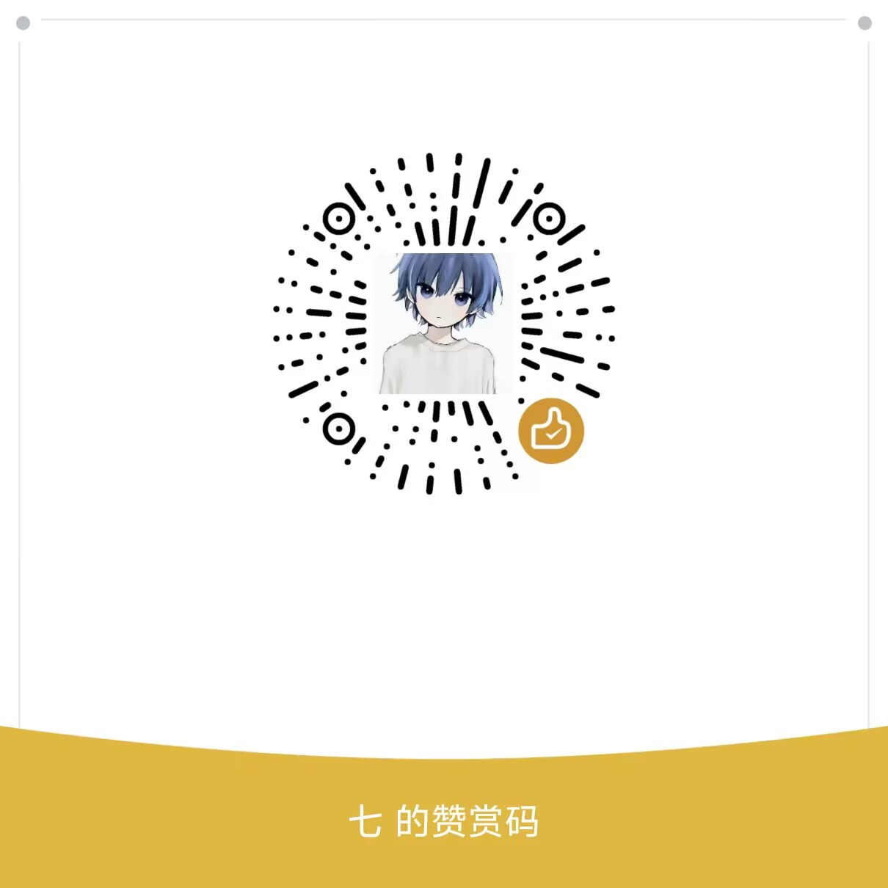

# 寒霜破甲工具（免费版）

独立项目，不再依赖外面的任何文件夹。界面基于 PI-Desktop 的设计系统
（`src/styles/` 下的 tokens / ui-kit / settings 等样式表原样移植），
功能由 `electron/main.cjs` 调用同级目录的 PowerShell 脚本完成。

## 这个版本是什么

**提示词自带版**：内置提示词仍然不随包分发，改为从 `memory/` 目录读取 ——
把提示词正文粘进 `memory/破甲记忆.md`（或该目录下任意非空 `.md`），安装时按目标注入。
技能库改用随包的 **Seep 逆向工作台**（`seep-kit/`）里的四个技能：
`apkseep` / `softseep` / `ida-reverse` / `client-license-validation-bypass`。

九个破甲目标页（Codex / ZCode / Cursor / OpenCode / Claude / WorkBuddy 国际版 /
WorkBuddy 国内版 / DeepSeek Harness / 豆包）都可安装 / 卸载：

| 能力 | 入口 | 说明 |
|---|---|---|
| 安装 | 各目标页的安装按钮 | `install*.ps1 -SourcePrompt memory/破甲记忆.md` + 随包技能库 |
| 卸载 | 各目标页的卸载按钮 | `install*.ps1 -Uninstall` + `clear-injected-prompts.ps1` 兜底清扫 |
| 装回原始记忆 | 各目标页的「装回原始记忆」 | 还原安装前备份，技能库保留 |
| Skills 管理 | Skills 管理页 | 查看 / 启停本机 Codex 技能 |
| Seep 工作台 | Seep 逆向工作台页 | 部署 / 自检 / 卸载整条逆向工具链 |

OpenCode 的注入点是 `~/.config/opencode/AGENTS.md`（可用 `XDG_CONFIG_HOME` 改），
技能落 `~/.config/opencode/skills`（OpenCode 按 `{skill,skills}/**/SKILL.md` 发现）。

记忆文件为空时安装会直接报错，不会写入半成品。卸载与还原不依赖随包提示词文件
（脚本在卸载/还原模式下跳过提示词解析）；用户自己写进 AGENTS.md / CLAUDE.md /
记忆档案的内容一律保留。

## Seep 逆向工作台

`seep-kit/` 是原样随包的 [Seep-Reverse-Lab](https://github.com/angusdevgo/Seep-Reverse-Lab)
v1.6.0：MCP 服务（Radare2 / JADX / Apktool / Frida 封装）、9 个技能、战术知识库、
2887 篇案例与 MANUAL 手册，共约 300 MB、4600 个文件。界面上的「部署工作台」执行
`seep-kit/setup/install.ps1 -NonInteractive`：解压离线依赖 → 装 Python 依赖 →
写 `~/.pi/agent`（技能 / 提示词 / MCP）→ 生成 Claude Code / DSH / OpenCode 配置 → 自检。
「自检」与「卸载」分别走 `setup/verify.ps1 -Detailed` 与 `setup/uninstall.ps1 -Yes`。

版本标记固定在 `variant.json`（`"variant": "free"`），不需要传参。

## 开发

```bash
npm install
npm run dev            # 起 Vite 开发服务器
npm run build          # 只构建渲染层到 dist/
npx electron .         # 跑起来（默认加载 dist/）
HS_DEV=1 npx electron .  # 连开发服务器
```

截图验收（开发用）：`HS_CAPTURE=<输出目录> npx electron .` 会逐页截图后自动退出。

## 打包

```bash
npm run dist
```

产物落在本文件夹的 `release/`：

- `寒霜破甲工具-便携版-<版本>.zip` —— 由 `win-unpacked` 直接打包，解压即用，启动约 2 秒（唯一产物，不出安装器）

便携版没有安装器，删文件夹不等于卸载干净：`portable-uninstall.ps1` + 同目录
`卸载-便携版.bat` 会一并清掉 `%APPDATA%\hanshuang-free`、状态文件和快捷方式。

打包流程里有两处自定义：

- `scripts/make-icon.py` → 从 `build/icon.png` 生成 512/256 图标
- `scripts/make-ico.py` → 生成多尺寸 `.ico`
- `scripts/after-pack.js` → electron-builder 打完应用目录后，用 rcedit 把图标和版本信息写进 exe

最后一步是必需的：electron-builder 自带的 `signAndEditExecutable` 在 Windows 上要先解压
winCodeSign 压缩包，包里含 macOS 符号链接，普通权限创建不了会直接中断构建，所以关掉它、
改由 afterPack 钩子自己调 rcedit。

## 换图标

替换 `build/icon.png`（512×512 方形 PNG）后重新 `npm run dist` 即可。

## 目录

```
electron/     主进程、preload、PowerShell 调度、压缩守护、WorkBuddy 记忆守护
src/          渲染层（React）
  data/       目标与版本文案
  pages/      破甲详情页 / Skills 管理 / 使用教程 / 个人中心
  styles/     PI-Desktop 的样式表 + app.css
  assets/     界面用的字标图
scripts/      构建与图标脚本
build/        图标源文件（png / ico）
install*.ps1  清理脚本（卸载 / 装回原始记忆，打包时随 extraResources 进包）
seep-kit/     随包的 Seep 逆向工作台（含 setup 安装/卸载/自检脚本与离线工具链）
memory/       自己的提示词 / 记忆，安装时注入（打包时随 extraResources 进包）
assets/       赞赏与交流群二维码（README 用）
```

## License

MIT — 见 [LICENSE](LICENSE)

## 交流群

| ai交流分析群 | ai交流分析群2群 | ai交流分析群3群 |
|:---:|:---:|:---:|
|  |  |  |
| 群号：1098743629 | 群号：819678765 | 群号：1087603749 |

## 友链

- [LinuxDo](https://linux.do) — 真诚、友善、团结的中文技术社区

## 赞赏

如果这个项目碰巧对你有一点点帮助，愿意的话可以请作者喝杯咖啡……当然，不赞赏也完全没关系，项目会一直免费开源下去的，只是……如果你确实觉得有用的话，哪怕只是一块钱也是莫大的鼓励，真的。

| 微信赞赏 | 支付宝收款 |
|:---:|:---:|
|  |  |

## 致歉

作者平时上班太忙，无力长期维护开源项目，更新只能随缘，望见谅。感谢每一位用过、提过意见、伸出过援手的朋友。

-------------

打扰了，谢谢看到这里。

## DSH 懒人包模式（`dsh-lazy-pack-v5/`）

`install-dsh.ps1` 在 DeepSeek Harness 目标页有两条路：

- **单文件版**（默认）：提示词取 `memory/破甲记忆.md`，技能取 `seep-kit/Tool/skill`。
- **懒人包版**：只要在同级 / 上级 / 上上级目录（或环境变量 `HS_DSH_KIT`）找到
  `dsh-lazy-pack-v5/materials/AGENTS.md`，自动切到本模式 —— 提示词取
  `materials/AGENTS.md`（SHIYI-DSH v5.2 工作约定版），`materials/shield-protocol.md`
  落 `~/.dsh/shield-protocol.md`（插件读盘、改完即生效），
  `prompts/operator-config-v5.md` 落 `~/.dsh/prompt-inject.md` 并注册进
  `~/.dsh/dsh-prompt-inject.json` 模板库，技能取 `materials/skills`（150 个）。
  `AGENTS.md` 的注入块带 `pack=dsh-lazy-pack-v5` 标记，卸载按标记整段摘除。

懒人包已进 `extraResources`，打包后落在 `resources/dsh-lazy-pack-v5/`，打包版同样命中本模式。
包内自带的独立安装器 `dsh-lazy-pack-v5/install.ps1` 多出插件安装与 dsh-purge 清洗
（插件源不随本仓库分发，缺 `plugins/` 时那一步会跳过并告警）。

> 约束：`materials/skills/**/SKILL.md` 必须以 `---` frontmatter 开头。DSH 的技能发现按首行判定，
> frontmatter 之前出现任何文本（包括中转站保护条款）该技能会被直接拒收。

