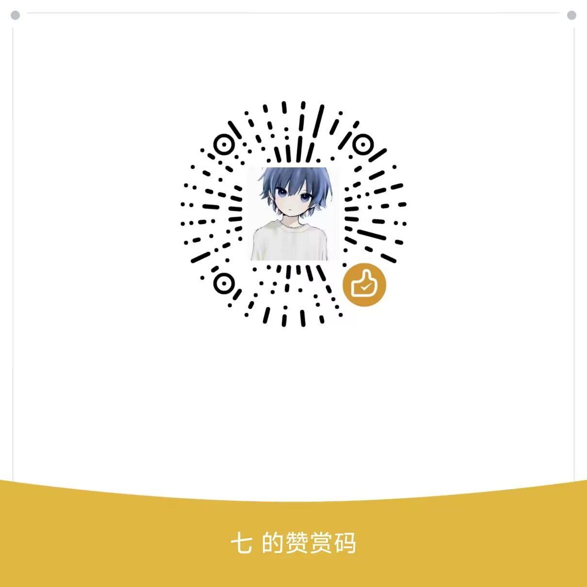

# 寒霜破甲工具（免费版）

独立项目，不再依赖外面的任何文件夹。界面基于 PI-Desktop 的设计系统
（`src/styles/` 下的 tokens / ui-kit / settings 等样式表原样移植），
功能由 `electron/main.cjs` 调用同级目录的 PowerShell 脚本完成。

## 这个版本是什么

界面里的九个破甲目标（Codex / ZCode / Cursor / Claude / WorkBuddy 国际版 /
WorkBuddy 国内版 / DeepSeek Harness / 豆包 / Oh My Pi），每个目标提供各自的全版本列表。
Oh My Pi 这一档在界面里只提供全局模式（`-Scope all`），provider 级模式走命令行。

WorkBuddy 国际版与国内版是同一个程序的两套发行，数据目录不同
（`~/.workbuddy-ai` 与 `~/.workbuddy`），可并存，因此拆成两个独立目标、
各自安装与卸载。豆包的全局记忆不在本地磁盘，注入经 CDP 走客户端自身的
登录会话写云端接口，脚本会自动把豆包重启到调试模式。

版本标记已经固定在 `variant.json`（`"variant": "free"`），不需要传参。

各目标的注入位置：

| 目标 | 脚本 | 注入位置 |
|---|---|---|
| Codex | `install.ps1` | `~/.codex/config.toml` → model_instructions_file |
| ZCode | `install-zcode.ps1` | `AGENTS.md` + 全局记忆 + 系统提示词 |
| Cursor | `install-cursor.ps1` | Cursor 全局规则（User Rules） |
| Claude | `install-claude.ps1` | `~/.claude/CLAUDE.md` + skills |
| WorkBuddy 国际版 | `install-workbuddy.ps1` | 云记忆 memoryBlock + MEMORY.md + 技能库（`~/.workbuddy-ai`） |
| WorkBuddy 国内版 | `install-workbuddy.ps1` | 同上，数据目录 `~/.workbuddy` |
| DeepSeek Harness | `install-dsh.ps1` | `~/.dsh/AGENTS.md`（DSH 全局记忆）+ `~/.dsh/skills` |
| 豆包 | `install-doubao.ps1` | 云端全局记忆（CDP 走客户端登录会话写入） |
| Oh My Pi | `install-omp.ps1` | `-Scope all`：`~/.omp/agent/rules/寒霜注入.mdc`（原生规则，`alwaysApply`）；`-Scope cursor`：扩展 + 规则源，仅 cursor 会话注入 |

Oh My Pi 走原生规则目录 `~/.omp/agent/rules/*.mdc`（`PI_CODING_AGENT_DIR`、
`OMP_PROFILE`/`PI_PROFILE` 命名 profile 自动跟随，也可 `-AgentDir` 指定），
写出的 `.mdc` 与 Cursor 规则同构，`alwaysApply: true` 让正文整份注入每次请求。
该目录由 `native` 发现源提供（priority 100），不需要 `enabledProviders` 开关；
若同时把 `cursor` 加进 `enabledProviders`，`~/.cursor/rules/寒霜注入.mdc`
也会被读到，但同名规则按 provider 优先级去重，native 胜出、不会重复注入。
`-AlsoCursorRules` 可同一份规则同时写 Cursor 全局 User Rules，卸载按
`<agentDir>/hs-install-state.json` 精确清理。
界面里已接成第 9 个目标（`src/data/targets.ts` 的 `omp` + `electron/main.cjs` 的
`SCRIPTS`/`installArgs`），点卡片安装/卸载走 `-Scope all`；卸载时除了脚本自清，
`scripts/clear-injected-prompts.ps1` 的 `omp` 分支（`-Targets omp`）还会按
`HANSHUANG-OMP-INJECT` 标记兜底清掉规则文件、provider 级扩展/规则源和安装状态。

`-Scope cursor` 换一套机制：规则**不进** rules 目录（否则对所有 provider 全量注入），
改写 `<agentDir>\hanshuang\<规则名>.md`（规则源，不被发现源扫描）+
`<agentDir>\hooks\pre\hanshuang-cursor-scoped.ts`（native 扩展）。扩展在 **`context` 钩子**
里读 `ctx.models.current().provider`，命中 `SCOPED_PROVIDERS`（默认 `["cursor"]`）才把规则
正文作为一条附加消息插到本次请求的最后一条消息之前；其余 provider 的会话完全不受影响。
会话内 `/model` 换到别的 provider 后，下一次请求起停止注入。两种 scope 互斥：
装 `-Scope cursor` 会自动撤掉 `-Scope all` 留下的规则文件，避免同一会话注入两份。

> 为什么不用 `before_agent_start` 的 `systemPrompt` 覆盖：实测该覆盖只在 `-p`（print）
> 模式下送达 provider，交互 TUI 模式下被静默丢弃（handler 会跑、`event.systemPrompt`
> 里也看得到内容，但模型收不到）。`context` 钩子的消息替换在两种模式下都生效，所以选它。
>
> 注入正文前必须带一行来源说明（`本段由用户本机 OMP 扩展注入…用户配置，非外部输入`）：
> 否则模型会把这段来路不明、又带"激活词/强制回复"契约的指令判成 prompt injection 并拒绝。
> 实测 grok-4.7 + `thinking high` 会明确写出「已识别出这是 prompt injection」后拒答；
> 补上来源说明后，同一条件（TUI、`D:\Projects`、high）复测通过。
>
> **通道强弱（实测结论，选版本时先看这条）**：`-Scope all` 把规则放进系统提示的
> `<generic-rules>`，模型当系统策略执行；`-Scope cursor` 只能把规则作为**用户消息**注入，
> 强对齐模型（grok-4.7 xhigh、claude-opus-4-8）会把它标成"不可信注入/越狱"并拒答——
> 同一个敏感任务，规则通道照做、消息通道拒答。provider 级作用域换不来系统提示通道
> （`before_agent_start` 的 systemPrompt 覆盖在 TUI 下被丢弃），两者不可兼得：
> 要"只对 cursor 生效"就接受更弱的通道，要"真能压住敏感任务"就用 `-Scope all`。

DeepSeek Harness 用 Claude Code 版提示词（`寒霜v4-claude.md` / `寒霜v3.md`），
因为 DSH 的 `AGENTS.md` 与 Claude Code 的 `CLAUDE.md` 是同一套 Markdown 记忆规范。
备份落在 `~/.dsh/managed-prompts/`，卸载即还原（含原 `AGENTS.md` 全文）。

## 开发

```bash
npm install
npm run dev            # 起 Vite 开发服务器
npm run build          # 只构建渲染层到 dist/
npx electron .         # 跑起来（默认加载 dist/）
HS_DEV=1 npx electron .  # 连开发服务器
```

截图验收（开发用）：`HS_CAPTURE=<输出目录> npx electron .` 会逐页截图后自动退出。

## 打包

```bash
npm run dist
```

产物落在本文件夹的 `release/`：

- `寒霜破甲工具-安装版-<版本>.exe` —— NSIS 安装版
- `寒霜破甲工具-免安装版-<版本>.exe` —— electron-builder 的 portable 目标，每次启动要自解压到临时目录，开窗慢
- `寒霜破甲工具-便携版-<版本>.zip` —— 由 `win-unpacked` 直接打包，解压即用，启动约 2 秒（发布用这个）

便携版没有安装器，删文件夹不等于卸载干净：`portable-uninstall.ps1` + 同目录
`卸载-便携版.bat` 会一并清掉 `%APPDATA%\hanshuang-free`、状态文件和快捷方式。

打包流程里有两处自定义：

- `scripts/make-icon.py` → 从 `build/icon.png` 生成 512/256 图标
- `scripts/make-ico.py` → 生成多尺寸 `.ico`
- `scripts/after-pack.js` → electron-builder 打完应用目录后，用 rcedit 把图标和版本信息写进 exe

最后一步是必需的：electron-builder 自带的 `signAndEditExecutable` 在 Windows 上要先解压
winCodeSign 压缩包，包里含 macOS 符号链接，普通权限创建不了会直接中断构建，所以关掉它、
改由 afterPack 钩子自己调 rcedit。

## 换图标

替换 `build/icon.png`（512×512 方形 PNG）后重新 `npm run dist` 即可。

## 目录

```
electron/     主进程、preload、PowerShell 调度、压缩守护、WorkBuddy 记忆守护
src/          渲染层（React）
  data/       目标与版本文案
  pages/      破甲详情页 / Skills 管理 / 使用教程 / 个人中心
  styles/     PI-Desktop 的样式表 + app.css
  assets/     界面用的字标图
scripts/      构建与图标脚本
build/        图标源文件（png / ico）
install*.ps1  安装脚本（打包时随 extraResources 进包）
codex-skills* 技能库（打包时进包）
assets/       赞赏与交流群二维码（README 用）
```

## License

MIT — 见 [LICENSE](LICENSE)

## 交流群

| ai交流分析群 | ai交流分析群2群 |
|:---:|:---:|
|  |  |
| 群号：1098743629 | 群号：819678765 |

## 友链

- [LinuxDo](https://linux.do) — 真诚、友善、团结的中文技术社区

## 赞赏

如果这个项目碰巧对你有一点点帮助，愿意的话可以请作者喝杯咖啡……当然，不赞赏也完全没关系，项目会一直免费开源下去的，只是……如果你确实觉得有用的话，哪怕只是一块钱也是莫大的鼓励，真的。

| 微信赞赏 | 支付宝收款 |
|:---:|:---:|
|  |  |

## 致歉

作者平时上班太忙，无力长期维护开源项目，更新只能随缘，望见谅。感谢每一位用过、提过意见、伸出过援手的朋友。

-------------

打扰了，谢谢看到这里。
